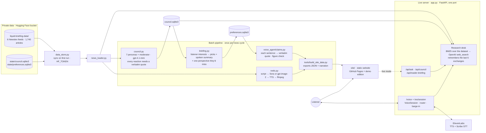
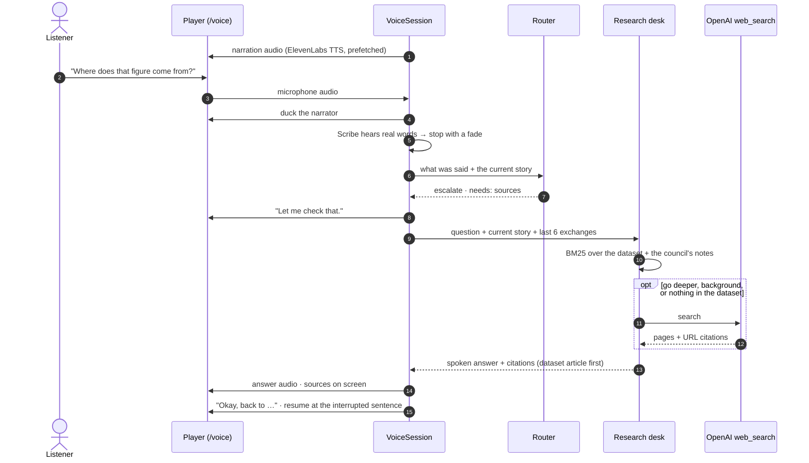

# The Daily Briefing · The News Council

**Nuanced. Personalized. Interactive.** Everyone reads the same news. No one reads it the same way.

**Website (demo edition):** https://sri-ram-swaminathan.github.io/daily-briefing/

* **Nuanced**: seven fictional people from very different lives (an epidemiologist, a baker, a
  tenants' organizer, a retired teacher, a delivery rider, an ex-journalist and a philosopher)
  each review every story and back their reaction with a verbatim quote. A neutral moderator sums
  up where they split.
* **Personalized**: a briefing agent picks the stories that matter to one listener and says why
  they matter to *them*. The demo has two: Max, a rates trader, and Lena, a student.
* **Interactive**: a spoken briefing you can interrupt. Ask "where's that from?", say "go deeper",
  skip ahead or go back. The research desk searches the dataset, then the web, cites every source,
  and remembers the conversation.

Built at the MAIN AI Hackathon, Maastricht, 20–21 November 2026, on the Liquid Briefing dataset
(Newstex). **The data is not in this repository.** It is synced from a private Hugging Face bucket
at startup (see [Data](#data)).

## Working prototype: the hand-in checklist

| Requirement | Where to see it |
|---|---|
| Generates audio briefings from the dataset | Website → **Your briefing** → ▶. Both briefings are picked by `briefing.py` from council reviews of Liquid Briefing articles only, written as spoken text and voiced (gpt-4o-mini-tts in the demo, ElevenLabs live). |
| At least two clearly different listener profiles | **Max** (rates trader: gold, Nvidia, oil, Intel, crypto) and **Lena** (student: young people out of work, UK jobs, travel chaos). "Compare them" shows the two mornings side by side, including how a shared story is explained differently. Live mode adds **You**. |
| Each claim linked to its source article | Every sentence ends in a marker. It opens the passage from the source article that supports it (checked verbatim against the article text), whether figures match, and the link. The player shows the source of the story it's reading. The research desk cites every answer. |

The front page of the website has the same checklist with one button per requirement.

## How it works



**Batch.** The council reads each article once; that cost is shared by every listener. For each
listener, `briefing.py` reads the council's notes (not the full articles), keeps what matches their
interests and writes two or three spoken sentences per story. `claims.py` then splits each story
into sentences and attaches the supporting passage from the article. A quote is only shown if it
appears in the article word for word, and every figure written in digits is checked against the
article.

**Live.** `app.py` serves the website, the voice page and the APIs on one port. The website runs as
a static **demo edition** from exported JSON (that's what GitHub Pages hosts). When it can reach a
server, it switches to the **live edition**: questions go to the research desk, pasted stories to
the council, and **Talk to it live** opens the interruptible voice briefing.

What happens when you interrupt:



Coughs and "mm-hm" don't stop the narrator; playback commands ("skip", "go back", "slower") are
handled without a model call. More detail: [docs/ARCHITECTURE.md](docs/ARCHITECTURE.md).

## Run it

```sh
cp .env.example .env      # OPENAI_API_KEY, ELEVENLABS_API_KEY, HF_DATA_URL, HF_TOKEN
uv run app.py             # http://localhost:7860
```

The first start syncs the data from Hugging Face. `FAKE_AUDIO=1` plays silent audio of the right
length, so you can work on the UI without spending ElevenLabs credits.

## Data

The repository contains code only. Article text is licensed (Newstex, for this hackathon only), so it
lives in a **private Hugging Face Storage Bucket** and `data_store.py` syncs it into the working copy
the first time something needs it. All of it is ignored by git.

| Path in the bucket | What | Needed? |
|---|---|---|
| `liquid-briefing-data/*.jsonl` (+ `README.txt`, `IDEAS_AND_TIPS.txt`) | The six Newstex feeds, 1,740 articles | **Yes** |
| `state/council.sqlite3` | The council's saved reviews | Recommended: otherwise rerun `council.py` (about $13 for every article) |
| `state/preferences.sqlite3` | Saved listener profiles and picks | Optional |
| `news-data/*.jsonl` | Our extra topic feeds | Optional, off by default (see below) |

```sh
# once, from a folder that has the data (needs a write token):
HF_WRITE_TOKEN=hf_... uv run tools/upload_data.py hf://buckets/<owner>/daily-briefing-data --from ../dass-news

# everywhere else (.env or Space secrets):
HF_DATA_URL=hf://buckets/<owner>/daily-briefing-data
HF_TOKEN=hf_...            # read token
```

`HF_DATA_URL` also accepts `https://huggingface.co/buckets/...` and private dataset repos
(`https://huggingface.co/datasets/<owner>/<name>`). To use local folders instead, set
`NEWS_DATA_DIRS` (os.pathsep-separated). Never put a token in the website: it would be public.

### Our additions (off by default)

The demo runs on the dataset the organisers provided, and nothing else. Extensions we built and
tested, ready to switch on later:

* **Extra topic feeds** (`tools/fetch_feeds.py`, `tools/feeds.yaml`): 23 public RSS feeds on weather,
  climate, sports, politics, the 2026 US midterms, finance and energy, in the exact Liquid Briefing
  JSONL format. Upload them as `news-data/` and set `INCLUDE_EXTRA_FEEDS=1`.
* **Web search** in the research desk (on; `WEB_SEARCH=0` limits it to the dataset).

## The website

`site/` is a static site styled like a pastel broadsheet, and it is the app's UI.

* **Demo edition** (GitHub Pages or any static host): everything comes from `site/data/*.json`,
  exported from the real pipeline. That covers Max's and Lena's briefings with narration and
  sentence-level sources, the council's reactions to 20 dataset stories, recorded research-desk
  conversations, reels, the newsroom flywheel and costs. Typed questions are answered from the
  stories on the page.
* **Live edition**: when the page reaches a server (same origin, `?api=URL`, or the URL box in the
  footer), you can build a briefing for **You**, ask the desk anything, paste a story for the
  council and talk to the voice briefing. Set `CORS_ORIGINS` on the server to your Pages origin.

Rebuild the demo data after new council runs:

```sh
uv run tools/build_site_data.py      # listeners, claim links, narration, desk Q&A, reels
uv run tools/crop_avatars.py         # portraits from img/1-4.png
```

`.github/workflows/pages.yml` publishes `site/` to GitHub Pages on every push to `main`
(Settings → Pages → Source: **GitHub Actions**).

## Research desk: web search and memory

`voice_agent/main_agent.py` answers what the briefing doesn't cover. It retrieves from the dataset
first (BM25), always cites the article the listener was hearing when it states the fact, then calls
OpenAI's hosted `web_search` tool. Web search is required for "go deeper", background and related
questions, or when the dataset has nothing. Web sources are read from the response's citation
annotations, never from the model's own text. Each session keeps its last six exchanges: "go deeper"
is anchored to the previous question, and earlier answers are marked as already told so they aren't
repeated. Answers are capped at about 190 words (300 for deep dives) and stripped of markdown and
links before they are spoken.

## Reels (TikTok, Reels, Shorts)

```sh
uv run reels.py --article <ARTICLE_ID> --audience student --dry-run   # script → reels/<audience>-<headline>/reel.json
# check the figures in reel.json against the article, edit if needed, then render:
uv run reels.py --article <ARTICLE_ID> --audience student
```

The model writes a ~20 second script for one audience (`student`, `finance`, `general` or free
text): an on-screen hook, a voice-over that paraphrases the article, two shot prompts (no real
people, logos or text), a caption and hashtags. Sora 2 renders each shot as a 12 second 720x1280
clip. Without Sora access, gpt-image-2 stills with a slow zoom stand in (`--stills` forces this).
gpt-4o-mini-tts reads the voice-over, and the bundled ffmpeg burns in captions, the hook and the
source credit.

## Link audit and costs

`tools/check_links.py` checks every permalink twice (httpx, then curl), compares each page title with
the headline, retries rate-limited sites slowly (`--recheck`) and applies human verdicts from
`data_quality/manual_review.json`. Results: [data_quality/README.md](data_quality/README.md). Every
dataset link works: 744 were verified automatically, and Zacks's links sit behind a bot wall that
blocks scripts but open normally in a browser. The per-article reports stay local (git-ignored),
because a list of every headline and URL would publish an index of the licensed dataset.

`tools/cost_model.py` estimates the cost of the full dataset and of ten times the volume
([docs/COSTS.md](docs/COSTS.md)).

## Agent models

Edit `models.yaml` to set the OpenAI model for each agent. Under `council`, keys match persona filenames without `.md`. The `moderator` entry controls synthesis and chat follow-ups, including synthesis with the built-in editor instructions. Custom personas use `default_persona` until you add their own entry. The `main_agent` entry controls personalized briefings and perspective selection.

All entries initially use `gpt-4.1-mini`. Choose models that support structured outputs. For a one-off override, both CLIs accept `--model`. The chat app and briefing CLI also honor `OPENAI_MODEL`, with the briefing CLI flag taking precedence. The voice agent's `voice_router` (what to do when you interrupt) and `research_desk` entries fall back to `main_agent` when unset. `ROUTER_MODEL` and `MAIN_AGENT_MODEL` override them for the voice agent.

## Listen: the live voice briefing

1. Run some council reviews (see **Batch reviews** below), e.g. `uv run council.py --limit 10`,
   or sync `state/council.sqlite3` from the bucket.
2. On the website (live edition), pick **You**, say what you follow, choose a delivery style and
   press **Build my briefing**. This runs the same sweep as `briefing.py --voice`.
3. Press **Talk to it live**. Tap the orb. Interrupt by speaking (headphones work best) or hold the
   space bar. You can also type questions.

A sample briefing is loaded at startup, so the player works before any reviews exist. Scripts can
also be pushed directly: `POST /api/briefings` takes paragraphs, the markup format or JSON
(`voice_agent/script.py`).

Delivery styles (`voice_agent/presets.py`): Coffee with a friend, Late-night radio, The
storyteller, Dry wit, 3-minute sprint and Calm explainer. Each sets the voice's tone and pace,
and the style the research desk answers in.

How interruptions work:

* While you talk, the narrator ducks at once and only stops (with a short fade) when ElevenLabs
  Scribe hears real words. A cough or "mm-hm" lets it carry on.
* Playback controls (pause, skip, repeat, slower) are handled directly. Anything the briefing
  doesn't cover goes to the **research desk**: BM25 search over the dataset plus the council's
  saved observations, written up by the OpenAI model as a short spoken answer with citations.
* After the answer it offers to go deeper. If you don't reply within 7 seconds it says
  something like "Okay, back to the Intel lawsuit" and replays the sentence you interrupted.

Other services can use the same pieces over HTTP: `POST /api/briefings` takes a script from
any summary agent, and `POST /api/main-agent` is the research desk. Set `MAIN_AGENT_URL` to
plug in your own research desk instead. The contract is in `voice_agent/main_agent.py`, and
the design is in [docs/ARCHITECTURE.md](docs/ARCHITECTURE.md).

## Hugging Face Spaces

Create a Space from this repository. Under **Settings → Variables and secrets**, add
`OPENAI_API_KEY`, `ELEVENLABS_API_KEY`, `HF_TOKEN` (read access to the data bucket) as secrets and
`HF_DATA_URL` as a variable. The Space runs `app.py`, which syncs the data on first start and serves
the website, the voice briefing and the APIs on port 7860. (The `sdk: gradio` header only tells
Spaces to run `app.py`; the app itself no longer uses Gradio.) If the browser blocks the microphone
inside the Space, open the voice page in its own tab.

## Batch reviews

Each persona independently reviews one article from the Liquid Briefing feeds. Reviews are committed to SQLite as they finish.

1. Add one Markdown file per reviewer in `personas/`, or use `--personas DIR` to choose another folder. The filename without `.md` is the reviewer ID (e.g. `amara`). Write the instructions directly in the file. Headings and lists are passed to the model as written.
2. Set `OPENAI_API_KEY` in your environment.
3. Run the first article with [uv](https://docs.astral.sh/uv/). It installs the dependencies declared in `pyproject.toml`.

```sh
uv run council.py --limit 1
```

The CLI reads the Markdown files before each article. When present, `moderator.md` supplies the instructions for the optional `--synthesize` pass. Other files supply independent reviewers. Add `--feed invezz_en` or `--language en` to filter articles. Omit `--limit` to process all matching articles.

Each new review sends the article to OpenAI. Invalid observations get one corrective retry. Rerunning the same command reuses completed results. Changing a persona's instructions creates a new version of its reviews and refreshes any requested synthesis. If a review still fails validation, the CLI reports it, continues processing, and defers that article’s synthesis until every reviewer succeeds. Rerun the same command to fill the gaps.

To display saved observations for the current Markdown personas and model, run:

```sh
uv run council.py --show-saved --limit 1
```

Add `--synthesize` to include a saved synthesis for the current council. The SQLite table keeps historical reviews, including results for removed personas and earlier prompt versions.

## Personalized briefings

After running batch reviews, save a reader's interests and exclusions, then sweep the council database for that reader.

```sh
uv run briefing.py --user alex --set-preferences "I follow European energy policy and its effect on household bills. Skip stock trading tips."
uv run briefing.py --user alex
```

The agent reads the latest saved observation per reviewer for each article, including an editor review when available. It sends relevant observations, supporting quotes, and the reader's preference text to the configured OpenAI model. Each matching article gets a short personalized summary and its source link. A sweep can return zero matches.

Run the sweep again after more council reviews arrive. An article is new to a reader until it has been recommended to that reader. Previously skipped items are reconsidered when preferences, review evidence, or the model changes. Use `--show-saved` to reread recommendations without an API call.

Profiles and recommendations are stored in the local `preferences.sqlite3` file. Use `--preferences-db PATH` to choose another location and `--db PATH` to read a different council database.

### Send a briefing to a voice agent

```sh
uv run briefing.py --user alex --voice
```

Each line of standard output is one story ready to read aloud. The presenter script opens with what happened and explains why it matters to the listener in two or three short sentences. A selected council perspective adds one attributed sentence. Source links, article IDs and supporting quotes are available in the regular display. An empty sweep produces no spoken text. The website's **You** reader runs this sweep for you and reads the stories aloud.

To replay a briefing you already generated, use `--show-saved --voice`. Older recommendations reuse their original wording.

### Explore a perspective over time

After three regular recommendations, the briefing agent looks for a stakeholder, consequence, or uncertainty missing from the next matching story’s summary. This is enabled by default. When several angles fit equally well, the agent is prompted to favor a reviewer shown less often. When it adds an angle, it includes the reviewer and article quote and starts the count again. If none fits, it checks the next match. The count carries across runs.

An optional personal note can guide the selection. It is stored locally and sent to the model during angle selection.

```sh
uv run briefing.py --user alex --set-perspective "I usually see energy prices through homeowners’ eyes. Help me see what renters experience."
```

Use `--show-perspective` to inspect the setting, `--clear-perspective` to delete the note and turn off extra perspectives, and `--default-perspective` to resume the default without a note.

### Measure the briefing

After reading an extra perspective, record whether it showed you something new. Use the article ID printed with the briefing. A second rating for the same article replaces the first.

```sh
uv run briefing.py --user alex --rate-angle ARTICLE_ID new
uv run briefing.py --user alex --metrics
```

The report counts recommendations tracked since measurement began, how many were checked for an extra angle, how many received one, and how many different reviewers supplied them. It shows how many angles the reader rated and how many of those they marked `new` (the other rating is `familiar`). Reviewer counts describe exposure. Voluntary ratings describe perceived novelty among the angles the reader chose to rate.

## Tests

```sh
uv run pytest
```

These cover the briefing perspectives, sentence chunking, routing, retrieval, the bridge from
council and briefing data to voice scripts, and full voice turn-taking against a simulated
browser: barge-in, false alarm, research handoff, and resuming at the interrupted sentence.

## Data licence

The Liquid Briefing data is licensed for the MAIN AI Hackathon 2026 only and must not be
republished, which is why it lives in a private bucket and never in this repository. The website
shows headlines, links, our own summaries and short attributed quotes only. The research desk is
told to paraphrase and keep quotes short, with links to the source article.
